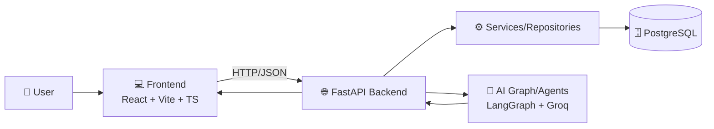

# 🧠 AIVOA - AI-Powered Pharma Complaint Management System

<div align="center">


</div>

> **Repository:** [`unknownmember4u/aivoa`](https://github.com/unknownmember4u/aivoa)  
> **Description:** *an AI-powered Customer Complaint Management System for the pharmaceutical manufacturing industry.*

---

## 📌 Overview

AIVOA is a full-stack complaint intelligence platform designed for **pharmaceutical manufacturing workflows**.  
It combines a **FastAPI + AI backend** with a **React + TypeScript frontend** to ingest, classify, route, and manage customer complaints.

This repository is organized into:
- `backend/` → API, AI orchestration, DB, domain services
- `frontend/` → Web interface for workflows, dashboards, and operator actions
- `sample complaints/` → Sample data inputs

---

## 🧰 Tech Stack

### Backend
- **Python**
- **FastAPI** (API framework)
- **Uvicorn** (ASGI server)
- **SQLAlchemy** + **asyncpg** (database access)
- **Alembic** (migrations)
- **Pydantic / pydantic-settings** (validation + config)
- **LangGraph** + **LangChain Core** + **LangChain Groq / Groq SDK** (AI orchestration)
- **python-jose** + **passlib[bcrypt]** (auth/security)

### Frontend
- **React 18 + TypeScript**
- **Vite**
- **Redux Toolkit + React Redux**
- **React Router**
- **React Hook Form + Zod**
- **Tailwind CSS** + **PostCSS + Autoprefixer**
- **Framer Motion**
- **Lucide React**
- **Axios**

---

## 🏗️ High-Level Architecture



---

## 📁 Repository Structure

```text
aivoa/
├── backend/
│   ├── .env.example
│   ├── requirements.txt
│   ├── seed.py
│   ├── start.sh
│   ├── alembic/
│   ├── tests/
│   └── app/
│       ├── main.py
│       ├── ai/
│       ├── api/
│       ├── config/
│       ├── core/
│       ├── db/
│       ├── graph/
│       ├── models/
│       ├── repositories/
│       ├── schemas/
│       ├── services/
│       └── utils/
├── frontend/
│   ├── package.json
│   ├── package-lock.json
│   ├── vite.config.ts
│   ├── tailwind.config.js
│   ├── postcss.config.js
│   ├── index.html
│   ├── bg-loginpage.mp4
│   ├── src/
│   │   ├── main.tsx
│   │   ├── App.tsx
│   │   ├── index.css
│   │   ├── app/
│   │   ├── assets/
│   │   ├── components/
│   │   ├── features/
│   │   ├── hooks/
│   │   ├── layouts/
│   │   ├── pages/
│   │   ├── routes/
│   │   ├── services/
│   │   ├── store/
│   │   ├── styles/
│   │   ├── types/
│   │   └── utils/
│   ├── public/
│   └── dist/
├── sample complaints/
├── start.sh
├── start_backend.sh
└── workflow_diagram.png
```

---

## ⚙️ Environment Variables (Backend)

Create `backend/.env` using `backend/.env.example`:

```dotenv
PROJECT_NAME="Pharma Complaint AI"
API_V1_STR="/api/v1"
ENVIRONMENT="development"

# Database
POSTGRES_SERVER="127.0.0.1"
POSTGRES_USER="postgres"
POSTGRES_PASSWORD="password"
POSTGRES_DB="complaints_db"
POSTGRES_PORT=5432

# Groq
GROQ_API_KEY="your-groq-api-key-here"

# CORS
BACKEND_CORS_ORIGINS='["http://localhost:3000"]'
SECRET_KEY="your-secure-random-string"
```

---

## 🚀 Getting Started

## 1) Clone the repository

```bash
git clone https://github.com/unknownmember4u/aivoa.git
cd aivoa
```

## 2) Backend setup

```bash
cd backend
python -m venv .venv
source .venv/bin/activate   # On Windows: .venv\Scripts\activate
pip install -r requirements.txt
```

## 3) Frontend setup

```bash
cd ../frontend
npm install
```

## 4) Run the full stack

From repo root:

```bash
./start.sh
```

- Backend runs on: `http://127.0.0.1:8000`
- Frontend runs on Vite default host/port (typically `http://localhost:5173`)

## 5) Run backend only

```bash
./start_backend.sh
```

or

```bash
cd backend
./start.sh
```

---

## 🧪 Build Commands

Frontend (`frontend/package.json`):

```bash
npm run dev       # start dev server
npm run build     # type-check + production build
npm run preview   # preview production build
```

---

## 🔐 Security & Auth Notes

Backend dependencies indicate support for:
- JWT handling via `python-jose`
- Password hashing via `passlib[bcrypt]`
- Secret-based signing via `SECRET_KEY`

Make sure to:
- Use strong production secrets
- Never commit `.env`
- Restrict CORS to trusted origins

---

## 📈 Why this architecture works

- **Separation of concerns** between UI, API, domain services, and AI logic
- **Async-ready backend** for scalable I/O operations
- **Typed frontend + typed schemas** for safer integration
- **AI graph orchestration** for flexible complaint analysis/routing pipelines

---
